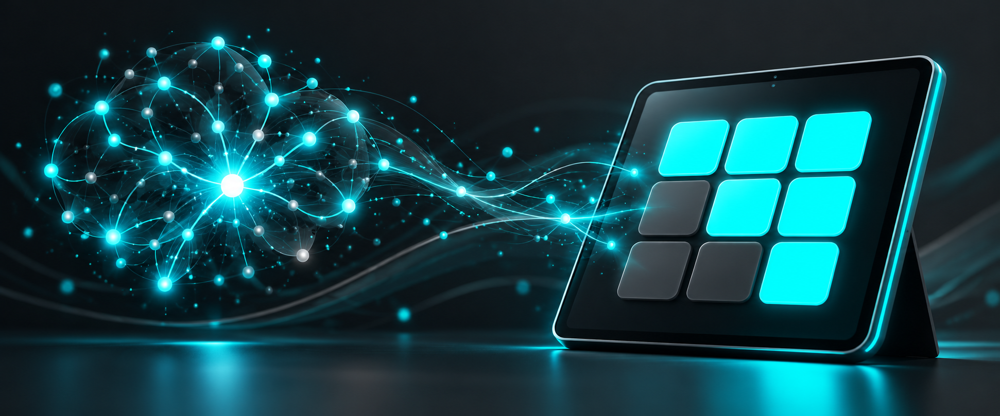
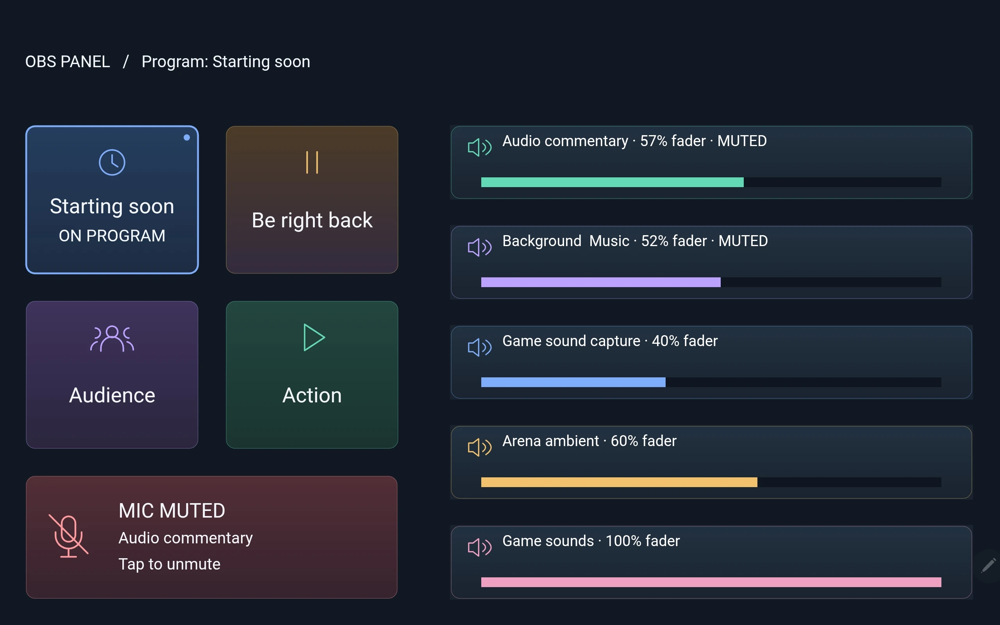
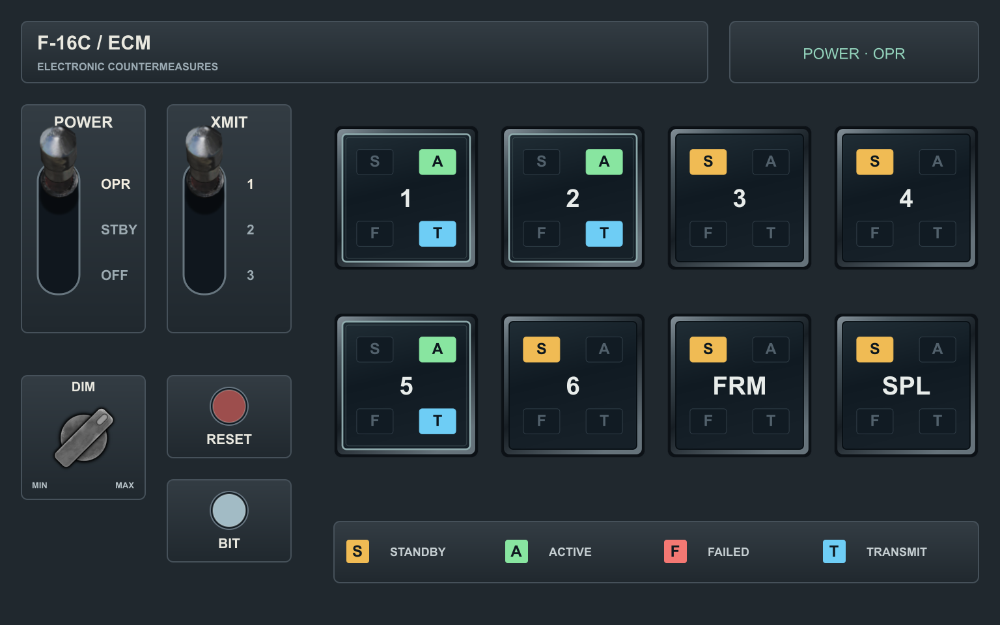
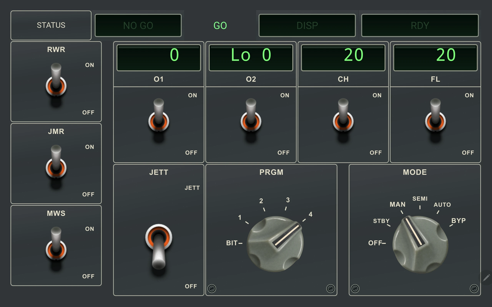

# MATRIC Deck Skill



Create a custom MATRIC control deck with your AI assistant. Describe the controls you want and the skill produces editable files and a `.deck` package to import into MATRIC.

Dynamic control images can declare additional resources that survive saving and follow library copies on supported MATRIC builds.

Build Digital Combat Simulator cockpit panels with controls and live simulator feedback through DCS-BIOS and DCS-BIOS-MATRIC-Middleware (DBMM). The skill can also use your input profiles to create panels for Microsoft Flight Simulator 2020/2024, X-Plane 11/12, Kerbal Space Program, Star Citizen, Elite Dangerous, Euro Truck Simulator 2, Farming Simulator, iRacing and Assetto Corsa Competizione. For OBS Studio, it can discover your own scenes, sources and settings from a live connection or an exported collection, then build a deck around your setup using MATRIC's OBS integration.

## Prompt examples and results

Describe the panel you want. These examples pair a prompt with the resulting layout.

### OBS Studio panel

> Use my OBS setup to build a tablet panel for scene switching, microphone mute and active-scene feedback.



### F-16 ECM panel

> Make a DCS F-16 ECM panel for a tablet in landscape orientation. It does not need to be absolutely photorealistic.



### F-16 CMDS panel

> Make an F-16 CMDS panel for a tablet in landscape orientation.



## Install

You need Python 3.11 or newer for the assistant’s helpers, and MATRIC to use the finished deck. No MATRIC source code or build is needed.

For Codex, ask the skill installer:

```text
$skill-installer install skills/matric-decks from the latest published release of
https://github.com/tgudelj/matric-deck-skill (resolve the latest release tag first).
```

For any supported assistant, download and extract the skill ZIP from the [latest release](https://github.com/tgudelj/matric-deck-skill/releases/latest), then copy the complete `matric-decks` folder to one of these locations. Personal installations are available across projects; project installations are available in that project.

| Assistant | Personal location | Project location |
| --- | --- | --- |
| Codex | `~/.codex/skills/matric-decks/` | `.agents/skills/matric-decks/` |
| Claude Code | `~/.claude/skills/matric-decks/` | `.claude/skills/matric-decks/` |
| Cursor | `~/.cursor/skills/matric-decks/` | `.cursor/skills/matric-decks/` |
| GitHub Copilot | `~/.copilot/skills/matric-decks/` | `.github/skills/matric-decks/` |
| Gemini CLI | `~/.gemini/skills/matric-decks/` | `.gemini/skills/matric-decks/` |

`~` is your home directory. Keep the contents together so that `SKILL.md` is directly inside the `matric-decks` folder. Reload skills or start a new session if the assistant does not find it.

For harness-specific commands, verification, cloud environments and updates, see the [installation guide](docs/INSTALLATION.md). The helper scripts and native MATRIC import have been tested; end-to-end use in Claude Code, Cursor, Copilot and Gemini CLI has not been tested by this project.

## Make a deck

Ask your assistant, for example:

```text
Use the matric-decks skill to make a 6-by-4 landscape deck with copy, paste,
media controls and a second page for text snippets. Package it for import.
```

For a DCS cockpit panel:

```text
Use the matric-decks skill to build an F-16C ICP panel using my installed
DCS-BIOS definitions, with simulator feedback and a DBMM output checklist.
```

Review the actions and any required integrations, then import the `.deck` in MATRIC. The skill does not install the deck or run its controls for you.

The published release also supports DCS-BIOS and DBMM cockpit panels. The skill also supports OBS discovery, application input configuration discovery, and custom applets. See [features and compatibility](docs/FEATURES.md) for details and limitations.

## More information

- [Installation and updates](docs/INSTALLATION.md)
- [Features and compatibility](docs/FEATURES.md)
- [Skill instructions and authoring references](skills/matric-decks/SKILL.md)
- [Development, testing and releases](docs/DEVELOPMENT.md)

This independent project is licensed under [MIT](LICENSE).
